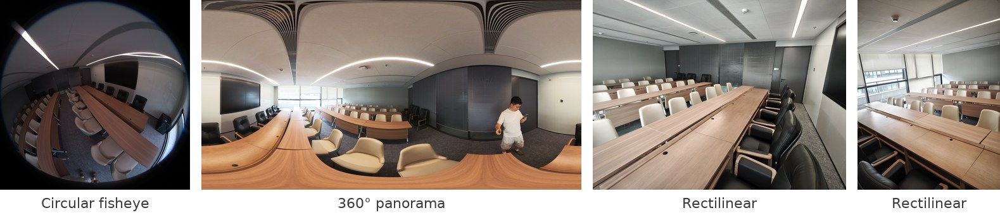
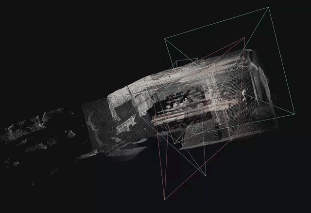
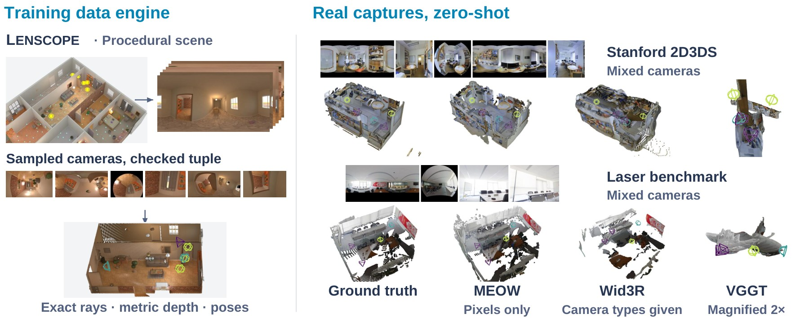
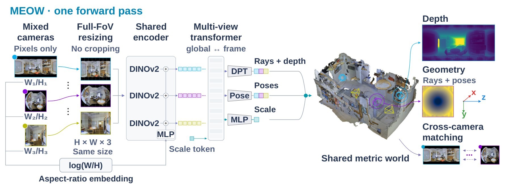
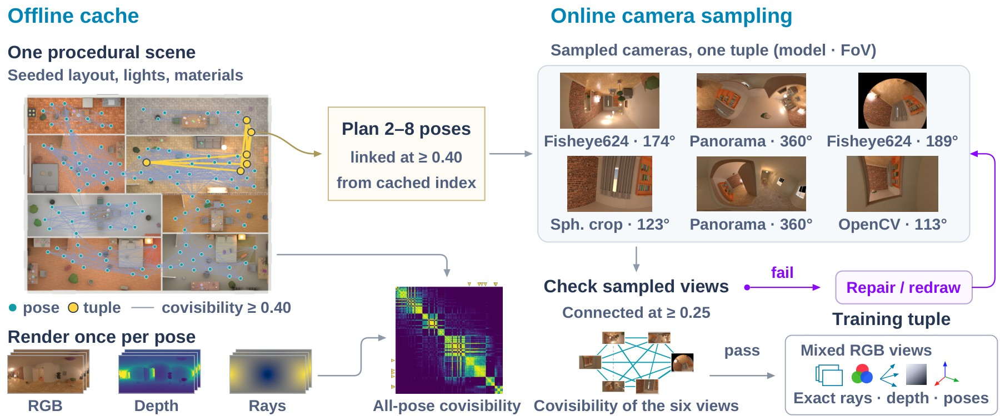
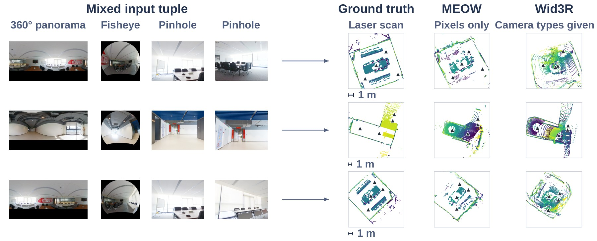
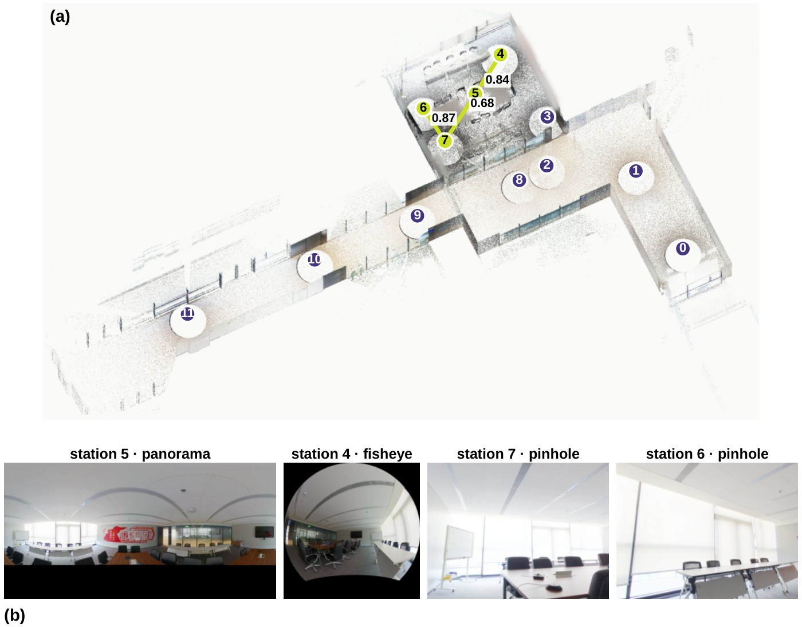

<div align="center">

[English](README.md) | [简体中文](README.zh-CN.md) | **日本語**

# MEOW: Many Eyes, One World

### 異種カメラ画像からのフィードフォワード3D再構成

Qiaoge Li<sup>1</sup>, Yifan Zhan<sup>2</sup>, Haijun Yang<sup>1</sup>, Haiyang Liu<sup>2</sup>, Yiyi Cai<sup>2</sup>, Chenchi Luo<sup>1</sup>

<sup>1</sup>China Mobile Communications Company Limited Research Institute &nbsp;&nbsp; <sup>2</sup>東京大学

[](https://arxiv.org/abs/2609.35658)
[](https://huggingface.co/qgli/MEOW-4D-Space-Reconstruction)
[](https://github.com/qgli/MEOW-het/releases/tag/v1.0)
[](LICENSE)




<em>3種類のカメラによる4枚の写真を、キャリブレーションやカメラ種別ラベルなしで一度の順伝播により同時再構成。視錐台は推定したカメラを示します。</em>

</div>

## ニュース

- **2026-10-22**：最終モデル（sB25、FP32）の重みを [Hugging Face](https://huggingface.co/qgli/MEOW-4D-Space-Reconstruction) に掲載しました。ダウンロードには著者による個別承認が必要です。
- **2026-09-29**：コード、設定、ベンチマーク定義、レーザースキャンベンチマークを公開しました。この時点ではモデル重みは未公開でした。

## 概要

MEOW は透視画像、魚眼画像、完全な360°パノラマを混在させた多視点画像群から、画像のみを用いて一度の順伝播でメートル尺度の点群マップとカメラ姿勢を同時に推定します。各画像のキャリブレーション、歪みパラメータ、カメラ種別ラベル、姿勢は不要です。全天球パノラマは画像の画素から判定します。一部の評価セットではセット全体にパノラマフラグを設定しています（[評価設定](docs/EVALUATION.md)）。

透視画像で事前学習した MapAnything のバックボーンを維持し、手続き的データエンジンで異種カメラを学習します。エンジンは連続的なカメラモデルの範囲で場面をレンダリングし、正確な光線と深度を提供するとともに、カメラをサンプリングした各学習画像群の共可視性を検証します。

<p align="center"></p>

<sub>左：Lenscope は手続き的な場面から異種カメラ画像を生成し、共可視性を確認して、正確な光線・メートル深度・カメラ姿勢を教師信号として提供します。黄色の印は選択したパノラマ中心です。右：Stanford 2D3DS とレーザースキャンから作成した混合カメラ画像群の再構成。MEOW は画像のみ、Wid3R は追加でカメラ種別ラベルを受け取ります。可視化では各点群を独立に相似変換で真値に整合させ、VGGT のパネルを2倍に拡大しています。</sub>

## 特徴

- **異種カメラを一度の順伝播で。** 透視・魚眼・全天球画像を同一の画像群に混在させ、全視点のメートル尺度点群マップと姿勢を共同推定します。
- **実画像へのゼロショット転移。** 合成画像群のみで学習し、Stanford 2D3DS の異種カメラ画像群で 80.4 mAA@30 を達成。各視点のカメラ種別が与えられる Wid3R は54.3です。
- **レーザースキャンベンチマーク。** 複数の部屋を含むオフィスの Leica BLK360 G2 による整合済み12地点、4トラック。混合トラックの AUC@30 は79.4、Wid3R は29.3です。
- **Lenscope データエンジン。** 手続き的な場面、正確な画素単位の光線・深度、カメラのサンプリング後に共可視性を再確認するオンラインサンプラーを提供します。

## 手法

<p align="center"></p>

<sub>各画像は視野を切り落とさず、共通のテンソル形状にリサイズします。元画像のアスペクト比（検出された全天球画像では2:1）を MLP でパッチトークンに加えます。16層の交互グローバル／フレーム内注意、視点ごとの密な予測ヘッド（パノラマは円環パディング）、姿勢ヘッド、スケールヘッドにより、共通の世界座標における光線・深度・OpenCV軸の camera-to-world 姿勢・メートル尺度を出力します。入力例はゼロショットの実画像です。</sub>

<p align="center"></p>

<sub>オフラインではシードから場面を生成し、自由空間にパノラマ姿勢を配置、光線と深度をレンダリングし、相互可視性により共可視性を計算します（線：c<sub>kl</sub> ≥ 0.40）。オンラインでは連結ウォークで2–8姿勢を選び、各姿勢をサンプリングしたカメラへ再投影します。共可視性を再計算し（線幅が強度、0.25未満は破線）、連結した画像群だけを採用します。</sub>

## 結果

Stanford 2D3DS の異種カメラ評価：3–24視点からなる88組を、それぞれ一度の順伝播で推定します。姿勢指標は各組で計算して88組にわたり平均し、ATE は Sim(3) 整合後に求めます。

| 手法 | カメラ側入力 | RRA@30 | RTA@30 | mAA@30 | ATE ↓ |
|---|---|:-:|:-:|:-:|:-:|
| VGGT | なし | 32.6 | 47.3 | 10.5 | 1.65 |
| π³ | なし | 45.9 | 59.7 | 19.8 | 1.24 |
| MapAnything | なし | 52.8 | 53.9 | 16.4 | 1.48 |
| CAM3R† | なし | – | – | – | – |
| **MEOW（提案手法）** | なし | 95.2 | **96.2** | **80.4** | **0.62** |
| Wid3R | 視点ごとの種別 | **96.9** | 86.5 | 54.3 | 0.83 |

† 多視点用の重みは未公開です。

レーザースキャン評価：各トラック24組、各組4視点。最初の6指標列は混合トラック（全天球・魚眼・ピンホール2枚）、最後の3列は単一カメラ種別トラックの AUC@30 です。AUC@30 は組ごとの平均。Acc・Comp は各組一度の整合後のメートル値、NC は法線整合性です。

| 手法 | カメラ側入力 | RRA@30 | RTA@30 | AUC@30 | Acc ↓ | Comp ↓ | NC | 全天球 | ピンホール | 魚眼 |
|---|---|:-:|:-:|:-:|:-:|:-:|:-:|:-:|:-:|:-:|
| DUSt3R | なし | 62.5 | 67.4 | 32.9 | 0.164 | 0.863 | 0.758 | 0.5 | 96.0 | 73.8 |
| MASt3R | なし | 66.7 | 66.0 | 31.8 | 0.182 | 0.508 | 0.737 | 2.7 | 96.2 | 56.2 |
| VGGT | なし | 45.8 | 63.9 | 19.0 | 0.279 | 0.591 | 0.665 | 1.9 | 97.1 | 55.0 |
| π³ | なし | 66.0 | 63.9 | 26.6 | 0.240 | 0.693 | 0.736 | 1.6 | **97.9** | 75.1 |
| MapAnything | なし | 66.0 | 57.3 | 24.5 | 0.255 | 0.830 | 0.653 | 1.5 | 86.8 | 75.1 |
| **MEOW（提案手法）** | なし | **100** | **100** | **79.4** | **0.142** | **0.367** | **0.809** | 71.0 | 85.7 | 73.2 |
| Wid3R | 視点ごとの種別 | 97.2 | 58.0 | 29.3 | 0.199 | 0.467 | 0.764 | 81.9 | 90.5 | **87.3** |
| PanoVGGT | 全天球 | – | – | – | – | – | – | **90.0** | – | – |

<p align="center"></p>

<sub>各行は入力4枚、レーザー真値、MEOW（画素のみ）と Wid3R（カメラ種別あり）の融合点群マップです。評価器の整合を適用しています。床から壁までの俯瞰断面を高さで着色し、三角形は計測地点または推定カメラを示します。</sub>

リサイズやパノラマフラグなど、各数値の設定は [評価文書](docs/EVALUATION.md) を参照してください。

## レーザースキャンベンチマーク

<p align="center"></p>

<sub>(a) 廊下と会議室をカバーする12地点（0–11）の統合点群。強調した地点5・4・7・6が混合画像群の一例で、連結の共可視性は0.84・0.68・0.87です。(b) そこから再投影した全天球1枚・魚眼1枚・ピンホール2枚をモデルに入力します。</sub>

データは CC BY 4.0 の独立アーカイブで配布しています：[meow_laser_benchmark.tar.gz](https://github.com/qgli/MEOW-het/releases/download/v1.0/meow_laser_benchmark.tar.gz)（636 MB、SHA-256：`5279045d2c92d4290d83564422f91054cbdad6ca1930257575187feb17d36aa3`）。トラック、選別条件、構築方法は [ベンチマーク文書](docs/BENCHMARKS.md) を参照してください。

## 公開内容

| 内容 | 説明 |
|---|---|
| データエンジン | 論文の Lenscope：2世代の Blender 場面生成器、正確な光線と深度、オフライン共可視性、学習用オンラインカメラサンプラー、レーザースキャン変換（[文書](docs/DATA_ENGINE.md)） |
| 学習 | 3段階の Hydra 設定、2×RTX 5090・4/8×H200・8×A100 40 GB のハードウェア設定、起動スクリプト、Stage-3 relay（[文書](docs/TRAINING.md)） |
| 評価 | 座標規約テスト付きベンチマーク構築、各セットの評価器・設定・ベースライン実行コード（[評価](docs/EVALUATION.md)、[ベンチマーク](docs/BENCHMARKS.md)） |
| モデル重み | 最終 sB25 を [Hugging Face](https://huggingface.co/qgli/MEOW-4D-Space-Reconstruction) に掲載。個別承認制（下記参照） |
| 再現性 | このコードで実施したチェック（[文書](docs/REPRODUCIBILITY.md)） |

親モデル2個と補間スクリプトは現時点では含みません。学習データ自体は配布していません。両世代の場面はシードから再生成できます。必要な Blender バージョンとアセットは [データエンジン文書](docs/DATA_ENGINE.md) に記載しています。

## モデル重み

最終推論モデル：[qgli/MEOW-4D-Space-Reconstruction](https://huggingface.co/qgli/MEOW-4D-Space-Reconstruction)。モデルページの手順に従って申請してください。申請だけで自動承認されることはありません。

[li.qiaoge@image.iit.tsukuba.ac.jp](mailto:li.qiaoge@image.iit.tsukuba.ac.jp) 宛てに Hugging Face ユーザー名、所属、利用目的をメールで送り、同じアカウントでモデルページからもアクセス申請してください。著者が承認するとダウンロードできます。

| チェックポイント | 形式 | サイズ | 評価バリアント |
|---|---|---|---|
| `MEOW-sB25.pth` | PyTorch、完全な FP32 モデルパラメータ | 5.05 GB | `:wrap` |

これは最終的な補間済み推論モデルであり、学習途中のチェックポイントではありません。モデルパラメータ全体を含みますがオプティマイザー状態は含まず、量子化モデルでもありません。

承認後、Hugging Face CLI でダウンロードします：

```bash
pip install -U huggingface_hub
hf auth login
hf download qgli/MEOW-4D-Space-Reconstruction MEOW-sB25.pth --local-dir checkpoints
export CKPT="$PWD/checkpoints/MEOW-sB25.pth"
```

評価スクリプトでは `MEOW=$CKPT:wrap` を指定します。異種カメラ入力では視野を保持し、画像からパノラマを自動判定します：

```bash
python scripts/realset/predict_ours.py \
    --tuples /path/to/tuples.json --frames-root /path/to/frames \
    --ckpt "MEOW=$CKPT:wrap" --input-resize squeeze --pano auto --out preds
```

データセット別のコマンドは [評価文書](docs/EVALUATION.md) を参照してください。

## クイックスタート

```bash
python3.10 -m venv .venv && . .venv/bin/activate
pip install -r requirements.txt
export PYTHONPATH=$PWD:$PWD/third_party/uniception
python scripts/convert_hf_to_benchmark_checkpoint.py --apache \
    --output_path checkpoints/facebook_map-anything-apache.pth
```

第1世代の場面を1個生成・レンダリングし、共可視性を計算、オンラインサンプラーで学習画像群を抽出して、10回の更新でパイプラインを確認します：

```bash
export WORK=$PWD/work BLENDER=/path/to/blender-4.5/blender
"$BLENDER" -b --python lenscope/gen1/generate_scene.py -- --seed 3 \
    --output_dir "$WORK/gen1/scenes" --room_type random --n_scenes 1
python lenscope/gen1/make_pick.py --blend-dir "$WORK/gen1/scenes" \
    --scenes proc_scene_000003 --out "$WORK/gen1/pick.json"
"$BLENDER" -b --python lenscope/gen1/render_fair_focal.py -- \
    --pick "$WORK/gen1/pick.json" --out "$WORK/gen1/packs" --num_poses 8 --samples 64
python scripts/compute_covisibility.py --root "$WORK/gen1/packs" --scenes proc_scene_000003 --overwrite
python scripts/repro/make_smoke_splits.py --scene proc_scene_000003 --out-dir "$WORK/gen1/splits"
python scripts/repro/smoke_injector_tuple.py --repo . --root "$WORK/gen1/packs" \
    --splits "$WORK/gen1/splits" --out "$WORK/gen1/tuple.json"
ENCODER_LR=0 scripts/repro/run_train_10steps.sh gen1 "$WORK/gen1/packs" "$WORK/gen1/splits" \
    checkpoints/facebook_map-anything-apache.pth "$WORK"      # 24 GB GPU では ENCODER_LR=0
```

## ディレクトリ構成

```text
lenscope/           データエンジン：gen1/ 第1世代、genesis/・core/・bpy/・fixtures/ 第2世代、blk/ レーザー、tests/
mapanything/        MEOW の変更を加えた MapAnything：モデル、損失、学習器、データセット、オンラインカメラサンプラー
third_party/        可変解像度への変更を含む UniCeption 0.1.7
configs/            Hydra 設定。meow_stage/ と meow_hardware/ にレシピを配置
scripts/            学習、データ準備、評価、ベンチマーク構築、競合実行、パイプライン確認
resources/          両世代の分割定義、第1世代のフレーム統計と実現可能性テーブル
benchmarks/         評価セット定義（フレーム一覧と画像群、画像そのものは含まない）
docs/               インストール、データエンジン、学習、評価、ベンチマーク、再現性（英語）
assets/             本ページの図とアニメーション
```

## 引用

```bibtex
@article{li2026meow,
  title   = {Many Eyes, One World: Feed-Forward 3D Reconstruction from Mixed Cameras},
  author  = {Li, Qiaoge and Zhan, Yifan and Yang, Haijun and Liu, Haiyang and Cai, Yiyi and Luo, Chenchi},
  journal = {arXiv preprint arXiv:2609.35658},
  year    = {2026}
}
```

## ライセンス

コードは [Apache License 2.0](LICENSE) で公開しています。MapAnything（Apache 2.0）と UniCeption（BSD 3-Clause）に基づきます。関連ライセンスと実行時に使用するデータ・アセットについては [THIRD_PARTY_NOTICES.md](THIRD_PARTY_NOTICES.md) を参照してください。
